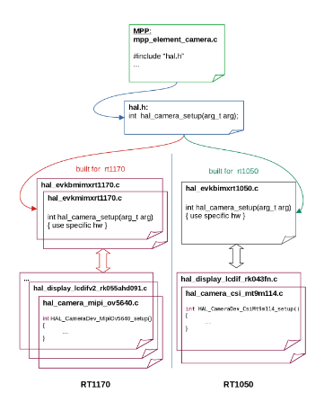

# eIQ MPP Hardware Abstraction Layer API

MPP-HAL VERSION 4.4

## Chapter 1

This is the documentation for the Hardware Abstraction Layer (HAL) API.

### 1.1 HAL overview

The hardware abstraction layer abstracts hardware and software components so that the vision pipeline can leverage hardware-accelerated components whenever they are available.

#### 1.1.1 MPP HAL description

The HAL is organized around the following conventions:

- A common header file hal.h includes all hardware top-level functions.
- All hardware top-level functions use the prefix hal_ .
- For each platform, all hal_ functions defined in hal.h must be implemented (at least as empty stubs).

Here is an overview:

**Figure 1.1 HAL overview**

#### 1.1.2 MPP HAL components

1. **Source elements HAL**
- Camera (MIPI CSI, FlexIO, USB/UVC)
- Static image (from memory buffer)
- File source (from SD card storage)
- Multicore source (receive frames from another core over RPMsg)
2. **Processing elements HAL**
- Graphics driver (image conversion, scaling, cropping, rotation, flip)
- Image decoder (JPEG SW/HW, H.264 SW)
- Vision algorithms (ML inference: TFLite, ExecuTorch)
- Labeled rectangle and landmarks drawing
3. **Sink elements HAL**
- Display panel
- File sink (write to SD card)
- RTSP/RTP network streaming sink
- Null sink
- Multicore sink (send frames to another core over RPMsg)
4. **Multicore HAL**
The `hal_mc` component provides inter-core communication for multicore pipelines on SoCs such as i.MX RT1170 (CM7 + CM4). It implements the `mc_dev_operator_t` interface and handles:
- RPMsg endpoint creation and teardown
- Shared-memory buffer negotiation between cores
- Synchronization locks for exclusive buffer access
- Enqueue/dequeue of frame buffers to/from the remote core
- MCMGR event signalling (when HAL_ENABLE_MULTICORE=1 )
The multicore HAL is enabled by setting `HAL_ENABLE_MULTICORE=1` in `mpp_config.h`.

#### 1.1.3 Supported devices

At present, the MPP HAL supports the following devices:

- Cameras:
    * OV5640 (MIPI CSI)
    * MT9M114 (parallel, deprecated)
    * OV7670 (FlexIO)
    * USB UVC cameras (e.g. Logitech C920 PRO HD WEBCAM)
- Displays:
    * LVGL (software framebuffer)
    * RK055AHD091 (MIPI DSI 720x1280)
    * RK055MHD091 (MIPI DSI 720x1280)
    * RK043FN02H-CT (parallel, deprecated)
    * Mikroe TFT Proto 5" (SSD1963 controller, FlexIO/LCD DBI)
    * NXP LCD-PAR-S035 (ST7796S controller, 8080 parallel)
    * FBdev (Linux framebuffer)
    * Zephyr display (via Zephyr display driver API)
- Graphics:
    * PXP (Pixel Pipeline, hardware accelerated)
    * VGLite (GPU, hardware accelerated)
    * CPU (software)
- Image decoders:
    * JPEG SW decoder
    * JPEG HW decoder
    * H.264 SW decoder
- Storage:
    * SD card (FatFS)
- RTSP/RTP streaming:
    * H.264 RTP streaming over UDP
- Multicore communication:
    * RPMsg + MCMGR (i.MX RT1170 CM7/CM4)

#### 1.1.4 Supported boards

Currently, the MPP HAL supports the following boards:

- evkbmimxrt1170 is supported with the following devices:
    * Cameras: OV5640.
    * Displays: LVGL, RK055AHD091 and RK055MHD091.
    * Graphics: PXP, CPU.
    * Decoders: JPEG SW, JPEG HW.
- frdmmcxn947 is supported with the following devices:
    * Cameras: OV7670.
    * Displays: Mikroe TFT Proto 5" and NXP LCD-PAR-S035.
    * Graphics: CPU.
    * Decoders: JPEG SW.
- mimxrt700evk is supported with the following devices:
    * Cameras: OV7670, USB UVC (Logitech C920 PRO HD WEBCAM).
    * Displays: RK055AHD091 and RK055MHD091.
    * Graphics: PXP, VGLite, CPU.
    * Decoders: JPEG SW, JPEG HW.
    * Storage: SD card.
    * Streaming: RTSP/RTP H.264 (multicore: core0 + core1).
    * Multicore: RPMsg + MCMGR (CM33 + CM33).
- frdmimxrt700 is supported with the following devices:
    * Cameras: OV7670, USB UVC.
    * Displays: Raspberry Pi 7".
    * Graphics: VGLite, CPU.
    * Decoders: JPEG SW, JPEG HW.
    * Storage: SD card.
- frdmimxrt1152 is supported with the following devices:
    * Cameras: OV5640.
    * Displays: RK055AHD091 and RK055MHD091.
    * Graphics: PXP, CPU.
    * Decoders: JPEG SW, JPEG HW.

How to port new boards/devices:
The MPP HAL provides the flexibility for users to port new boards and devices (cameras, displays, etc.).

Supporting new boards:
To support a new board, add a new file `hal_{board_name}.c` under the `hal/` directory. The file must implement all hardware-specific setup functions declared in `hal.h`.

Supporting new devices:
The HAL components that can support new devices are:

- Cameras
- Displays
- Graphics processing

A new device can be supported by:

- Providing the appropriate hal_{device_module} implementation.
- Adding its name and setup entry point to the appropriate device list in the associated board file hal_{board_name}.c .

Enabling/Disabling HAL components and devices:
- HAL components can be enabled or disabled from mpp_config.h using compilation flags of the form HAL_ENABLE_{COMPONENT_NAME} .
- Individual HAL devices can also be enabled or disabled from mpp_config.h using flags of the form HAL_ENABLE_{DEVICE_NAME} .

## Chapter 2

**Data Structures**

- struct [camera_dev_static_config_t](#camera_dev_static_config_t)
- struct [camera_dev_private_capability_t](#camera_dev_private_capability_t)
- struct [_camera_dev](#_camera_dev)
- struct [virtual_usb_cam_config_msg_t](#virtual_usb_cam_config_msg_t)
- struct [virtual_usb_cam_req_msg_t](#virtual_usb_cam_req_msg_t)
- struct [virtual_usb_cam_rsp_msg_t](#virtual_usb_cam_rsp_msg_t)
- struct [virtual_usb_cam_msg_t](#virtual_usb_cam_msg_t)
- struct [static_image_static_config_t](#static_image_static_config_t)
- struct [_static_image](#_static_image)
- struct [filesrc_config_t](#filesrc_config_t)
- struct [_filesrc](#_filesrc)
- struct [filesink_config_t](#filesink_config_t)
- struct [_filesink](#_filesink)
- struct [rtspsink_config_t](#rtspsink_config_t)
- struct [_rtspsink](#_rtspsink)
- struct [gfx_surface_t](#gfx_surface_t)
- struct [gfx_rotate_config_t](#gfx_rotate_config_t)
- struct [_gfx_dev](#_gfx_dev)
- struct [hal_rect_t](#hal_rect_t)
- struct [vdec_h264_frame_info_t](#vdec_h264_frame_info_t)
- struct [_vdec_dev](#_vdec_dev)
- struct [_vdec_h264_dev](#_vdec_h264_dev)
- struct [model_param_t](#model_param_t)
- struct [valgo_dev_private_capability_t](#valgo_dev_private_capability_t)
- struct [vision_frame_t](#vision_frame_t)
- struct [_vision_algo_dev](#_vision_algo_dev)
- struct [_display_dev_private_capability](#_display_dev_private_capability)
- struct [_display_dev](#_display_dev)
- struct [hw_buf_desc_t](#hw_buf_desc_t)
- struct [hal_img_decoder_setup_t](#hal_img_decoder_setup_t)
- struct [hal_graphics_setup_t](#hal_graphics_setup_t)
- struct [hal_display_setup_t](#hal_display_setup_t)
- struct [hal_camera_setup_t](#hal_camera_setup_t)
- struct [checksum_data_t](#checksum_data_t)
- struct [mc_dev_operator_t](#mc_dev_operator_t)
- struct [mc_dev_static_buf_config](#mc_dev_static_buf_config)
- struct [mc_dev_static_config_t](#mc_dev_static_config_t)
- struct [_multicore_dev](#_multicore_dev)
- struct [venc_h264_frame_info_t](#venc_h264_frame_info_t)
- struct [_venc_h264_dev](#_venc_h264_dev)

**Macros**

- #define [MAX_STREAM_REQUESTERS](#max_stream_requesters)
- #define [TARGET_CAMERA0_WIDTH](#target_camera0_width)
- #define [TARGET_CAMERA0_HEIGHT](#target_camera0_height)
- #define [TARGET_CAMERA1_WIDTH](#target_camera1_width)
- #define [TARGET_CAMERA1_HEIGHT](#target_camera1_height)
- #define [TARGET_CAMERA0_RESOLUTION](#target_camera0_resolution)
- #define [TARGET_CAMERA1_RESOLUTION](#target_camera1_resolution)
- #define [TARGET_CAMERA_MAX_RESOLUTION](#target_camera_max_resolution)
- #define [TARGET_CAMERA_FPS](#target_camera_fps)
- #define [CAMERA_DEV_BUFFER_ALIGN](#camera_dev_buffer_align)
- #define [CORE1_EPT_ADDRESS](#core1_ept_address)
- #define [MPP_EPT_ADDRESS](#mpp_ept_address)
- #define [RTSP_EPT_ADDRESS](#rtsp_ept_address)
- #define [APP_EP_READY_EVENT_DATA](#app_ep_ready_event_data)
- #define [FILE_SOURCE_FILEPATH_MAX_LEN](#file_source_filepath_max_len)
- #define [FILE_SINK_FILEPATH_MAX_LEN](#file_sink_filepath_max_len)
- #define [HAL_GFX_DEV_CPU_NAME](#hal_gfx_dev_cpu_name)
- #define [GUI_PRINTF_BUF_SIZE](#gui_printf_buf_size)
- #define [HAL_VDEC_DEV_NAME](#hal_vdec_dev_name)
- #define [MAX_INPUT_PORTS](#max_input_ports)
- #define [MAX_OUTPUT_PORTS](#max_output_ports)
- #define [HAL_DEVICE_NAME_MAX_LENGTH](#hal_device_name_max_length)
- #define [HAL_VENC_DEV_NAME](#hal_venc_dev_name)

**Typedefs**

- typedef int(* [camera\_dev\_callback\_t](#camera_dev_callback_t))(const camera_dev_t *dev, camera_event_t event, void *param, uint8_t fromISR)
- typedef void * [vision\_algo\_private\_data\_t](#vision_algo_private_data_t)
- typedef int(* [mpp\_callback\_t](#mpp_callback_t))(mpp_t mpp, mpp_evt_t evt, void *evt_data, void *user_data)
- typedef int(* [img\_decoder\_setup\_func\_t](#img_decoder_setup_func_t))(vdec_dev_t *)
- typedef int(* [graphic\_setup\_func\_t](#graphic_setup_func_t))(gfx_dev_t *)
- typedef int(* [display\_setup\_func\_t](#display_setup_func_t))(display_dev_t *)
- typedef int(* [camera\_setup\_func\_t](#camera_setup_func_t))(const char *, camera_dev_t *)

**Enumerations**

- enum [hal_camera_status_t](#hal_camera_status_t) {

  [kStatus_HAL_CameraSuccess](#kstatus_hal_camerasuccess),

  [kStatus_HAL_CameraBusy](#kstatus_hal_camerabusy),

  [kStatus_HAL_CameraNoData](#kstatus_hal_cameranodata),

  [kStatus_HAL_CameraNonBlocking](#kstatus_hal_cameranonblocking),

  [kStatus_HAL_CameraError](#kstatus_hal_cameraerror) }
- enum [camera_event_t](#camera_event_t) {

  [kCameraEvent_SendFrame](#kcameraevent_sendframe),

  [kCameraEvent_CameraDeviceInit](#kcameraevent_cameradeviceinit) }
- enum [virtual_usb_cam_msg_type_e](#virtual_usb_cam_msg_type_e) {

  [VIRT_USB_CAM_NOMSG](#virt_usb_cam_nomsg),

  [VIRT_USB_CAM_CONFIG](#virt_usb_cam_config),

  [VIRT_USB_CAM_CONFIG_ACK](#virt_usb_cam_config_ack),

  [VIRT_USB_CAM_CONFIG_ERR](#virt_usb_cam_config_err),

  [VIRT_USB_CAM_REQRGB](#virt_usb_cam_reqrgb),

  [VIRT_USB_CAM_REQIR](#virt_usb_cam_reqir),

  [VIRT_USB_CAM_REQRGBIR](#virt_usb_cam_reqrgbir),

  [VIRT_USB_CAM_RSPRGB](#virt_usb_cam_rsprgb),

  [VIRT_USB_CAM_RSPIR](#virt_usb_cam_rspir),

  [VIRT_USB_CAM_RSPRGBIR](#virt_usb_cam_rsprgbir),

  [VIRT_USB_CAM_ERROR](#virt_usb_cam_error) }
- enum [virtual_usb_cam_user_id_e](#virtual_usb_cam_user_id_e) {

  [RTSP_USER_ID](#rtsp_user_id),

  [MPP_USER_ID](#mpp_user_id) }
- enum [virtual_usb_cam_col_format_e](#virtual_usb_cam_col_format_e) {

  [VIRT_USB_CAM_JPEG](#virt_usb_cam_jpeg) }
- enum [hal_image_status_t](#hal_image_status_t) {

  [MPP_kStatus_HAL_ImageSuccess](#mpp_kstatus_hal_imagesuccess),

  [MPP_kStatus_HAL_ImageError](#mpp_kstatus_hal_imageerror) }
- enum [hal_filesrc_status_t](#hal_filesrc_status_t) {

  [MPP_kStatus_HAL_FileSrcSuccess](#mpp_kstatus_hal_filesrcsuccess),

  [MPP_kStatus_HAL_FileSrcError](#mpp_kstatus_hal_filesrcerror),

  [MPP_kStatus_HAL_FileSrcEOF](#mpp_kstatus_hal_filesrceof) }
- enum [hal_filesink_status_t](#hal_filesink_status_t) {

  [MPP_kStatus_HAL_FileSinkSuccess](#mpp_kstatus_hal_filesinksuccess),

  [MPP_kStatus_HAL_FileSinkError](#mpp_kstatus_hal_filesinkerror) }
- enum [gfx_rotate_target_t](#gfx_rotate_target_t) {

  [kGFXRotateTarget_None](#kgfxrotatetarget_none),

  [kGFXRotate_SRCSurface](#kgfxrotate_srcsurface),

  [kGFXRotate_DSTSurface](#kgfxrotate_dstsurface) }
- enum [hal_vdec_status_t](#hal_vdec_status_t) {

  [MPP_kStatus_HAL_VDecSuccess](#mpp_kstatus_hal_vdecsuccess),

  [MPP_kStatus_HAL_VDecSkipped](#mpp_kstatus_hal_vdecskipped),

  [MPP_kStatus_HAL_VDecError](#mpp_kstatus_hal_vdecerror) }
- enum [hal_valgo_status_t](#hal_valgo_status_t) {

  [kStatus_HAL_ValgoSuccess](#kstatus_hal_valgosuccess),

  [kStatus_HAL_ValgoMallocError](#kstatus_hal_valgomallocerror),

  [kStatus_HAL_ValgoInitError](#kstatus_hal_valgoiniterror),

  [kStatus_HAL_ValgoError](#kstatus_hal_valgoerror),

  [kStatus_HAL_ValgoStop](#kstatus_hal_valgostop) }
- enum [display_event_t](#display_event_t) {

  [kDisplayEvent_RequestFrame](#kdisplayevent_requestframe) }
- enum [hal_display_status_t](#hal_display_status_t) {

  [kStatus_HAL_DisplaySuccess](#kstatus_hal_displaysuccess),

  [kStatus_HAL_DisplayTxBusy](#kstatus_hal_displaytxbusy),

  [kStatus_HAL_DisplayNonBlocking](#kstatus_hal_displaynonblocking),

  [kStatus_HAL_DisplayError](#kstatus_hal_displayerror) }
- enum [mpp_memory_policy_t](#mpp_memory_policy_t) {

  [HAL_MEM_ALLOC_NONE](#hal_mem_alloc_none),

  [HAL_MEM_ALLOC_INPUT](#hal_mem_alloc_input),

  [HAL_MEM_ALLOC_OUTPUT](#hal_mem_alloc_output),

  [HAL_MEM_ALLOC_BOTH](#hal_mem_alloc_both) }
- enum [checksum_type_t](#checksum_type_t) {

  [CHECKSUM_TYPE_PISANO](#checksum_type_pisano),

  [CHECKSUM_TYPE_CRC_ELCDIF](#checksum_type_crc_elcdif) }
- enum [hal_mc_status_t](#hal_mc_status_t) {

  [kStatus_HAL_MultiCoreSuccess](#kstatus_hal_multicoresuccess),

  [kStatus_HAL_MultiCoreError](#kstatus_hal_multicoreerror),

  [kStatus_HAL_MultiCoreNoDataReq](#kstatus_hal_multicorenodatareq) }
- enum [hal_mc_dev_type_t](#hal_mc_dev_type_t) {

  [kHAL_MultiCoreDevTypeSink](#khal_multicoredevtypesink),

  [kHAL_MultiCoreDevTypeSource](#khal_multicoredevtypesource) }
- enum [hal_venc_status_t](#hal_venc_status_t) {

  [MPP_kStatus_HAL_VEncSuccess](#mpp_kstatus_hal_vencsuccess),

  [MPP_kStatus_HAL_VEncError](#mpp_kstatus_hal_vencerror) }

**Functions**

- int[ search_h264_nalu (](#search_h264_nalu)const uint8_t * data, int32_t len)
- int[ HAL_GfxDev_CPU_Register (](#hal_gfxdev_cpu_register)gfx_dev_t * dev)
- int[ HAL_GfxDev_GPU_Register (](#hal_gfxdev_gpu_register)gfx_dev_t * dev)
- void[ HAL_JPEG_PrintValidationStats (](#hal_jpeg_printvalidationstats)void)
- int[ HAL_JPEG_CPU_Register (](#hal_jpeg_cpu_register)vdec_dev_t * dev)
- int[ HAL_JPEG_HW_Register (](#hal_jpeg_hw_register)vdec_dev_t * dev)
- [hal_vdec_status_t ](#hal_vdec_status_t)[ HAL_VdecDev_H264_CPU_Register (](#hal_vdecdev_h264_cpu_register)vdec_h264_dev_t * dev)
- int[ setup_static_image_elt (](#setup_static_image_elt)static_image_t * elt)
- int[ setup_filesrc_elt (](#setup_filesrc_elt)filesrc_t * elt)
- uint32_t[ calc_checksum (](#calc_checksum)int size\_b, void * pbuf)
- [hal_venc_status_t ](#hal_venc_status_t)[ HAL_VencDev_H264_CPU_Register (](#hal_vencdev_h264_cpu_register)venc_h264_dev_t * dev)

### 2.1 HAL Types

This section provides the detailed documentation for the MPP HAL types.

#### 2.1.1 Function Documentation

##### search_h264_nalu

int search\_h264\_nalu ( const uint8_t * data, int32_t len )

Search function for H.264 NALU boundaries.

This function searches for H.264 Network Abstraction Layer Unit (NALU) start codes in the provided data buffer. It looks for:
- 4-byte start code: 0x00 0x00 0x00 0x01
- 3-byte start code: 0x00 0x00 0x01

**Parameters**

|in/out|name|description|
| - | - | - |
|in|data|Pointer to buffer containing H.264 bitstream data|
|in|len|Length of data in buffer (bytes)|

**Returns**

Offset to next NALU start code, or -1 if not found

##### HAL_GfxDev_CPU_Register

int HAL\_GfxDev\_CPU\_Register ( gfx_dev_t * dev )

Register the graphic device with the CPU operations.

**Parameters**

|in/out|name|description|
| - | - | - |
|in|dev|graphic device to register|

**Returns**

error code (0: success, otherwise: failure)

##### HAL_GfxDev_GPU_Register

int HAL\_GfxDev\_GPU\_Register ( gfx_dev_t * dev )

Register the graphic device with the GPU operations.

**Parameters**

|in/out|name|description|
| - | - | - |
|in|dev|graphic device to register|

**Returns**

error code (0: success, otherwise: failure)

##### HAL_JPEG_PrintValidationStats

void HAL\_JPEG\_PrintValidationStats ( void )

Print JPEG decoding validation statistics to the debug console.

##### HAL_JPEG_CPU_Register

int HAL\_JPEG\_CPU\_Register ( vdec_dev_t * dev )

Register the jpeg SW decoder device.

**Parameters**

|in/out|name|description|
| - | - | - |
|in|dev|decoder device to register|

**Returns**

error code (0: success, otherwise: failure)

##### HAL_JPEG_HW_Register

int HAL\_JPEG\_HW\_Register ( vdec_dev_t * dev )

Register the jpeg HW decoder device.

**Parameters**

|in/out|name|description|
| - | - | - |
|in|dev|decoder device to register|

**Returns**

error code (0: success, otherwise: failure)

##### HAL_VdecDev_H264_CPU_Register

[hal_vdec_status_t ](#hal_vdec_status_t) HAL\_VdecDev\_H264\_CPU\_Register ( vdec_h264_dev_t * dev )

Register the H.264 SW decoder device.

**Parameters**

|in/out|name|description|
| - | - | - |
|in|dev|decoder device to register|

**Returns**

error code (0: success, otherwise: failure)

##### setup_static_image_elt

int setup\_static\_image\_elt ( static_image_t * elt )

Register the static image source element.

**Parameters**

|in/out|name|description|
| - | - | - |
|in|elt|static image element to register|

**Returns**

error code (0: success, otherwise: failure)

##### setup_filesrc_elt

int setup\_filesrc\_elt ( filesrc_t * elt )

Register the file source element.

**Parameters**

|in/out|name|description|
| - | - | - |
|in|elt|file source element to register|

**Returns**

error code (0: success, otherwise: failure)

##### calc_checksum

uint32_t calc\_checksum ( int size\_b, void * pbuf )

Compute a 32-bit checksum over a memory buffer.

**Parameters**

|in/out|name|description|
| - | - | - |
|in|size\_b|buffer size in bytes|
|in|pbuf|pointer to the buffer|

**Returns**

32-bit checksum value

##### HAL_VencDev_H264_CPU_Register

[hal_venc_status_t ](#hal_venc_status_t) HAL\_VencDev\_H264\_CPU\_Register ( venc_h264_dev_t * dev )

Register the H.264 SW encoder device.

**Parameters**

|in/out|name|description|
| - | - | - |
|in|dev|encoder device to register|

**Returns**

error code (0: success, otherwise: failure)

#### 2.1.2 Data Structure Documentation

##### camera_dev_static_config_t

**struct camera\_dev\_static\_config\_t**

Structure that characterizes the camera device.

**Data Fields**

|type|name|description|
| - | - | - |
|int|height|buffer height|
|int|width|buffer width|
|int|pitch|buffer pitch|
|int|left|left position|
|int|top|top position|
|int|right|right position|
|int|bottom|bottom position|
|mpp_rotate_degree_t|rotate|rotate degree|
|mpp_flip_mode_t|flip|flip|
|int|swapByte|swap byte per two bytes|
|mpp_pixel_format_t|format|pixel format|
|int|framerate|frame rate|
|int|stripe\_size|stripe size in bytes|
|bool|stripe|stripe mode|
|uint32_t|n\_streams|number of total output video streams|
|uint32_t|min\_stream\_req\_cnt|minimum number of enqueue calls to wait for|
|uint32_t|crt\_stream\_req\_cnt|number of streams requested for enqueue|
|mpp_exec_flag_t|req\_cnt\_type|flag to control stream request counting|
|mpp_camera_stream_cfg|stream[NUM_STREAMS]|stream configuration|
|bool|stream\_requested[NUM_STREAMS]|flag to track if a stream is required for enqueue|
|void *|stream\_requester[NUM_STREAMS][MAX_STREAM_REQUESTERS]|array of requesters for each stream|
|bool|in\_advance\_enqueue|flag to indicate advance enqueue mode|

##### camera_dev_private_capability_t

**struct camera\_dev\_private\_capability\_t**

camera device private capability.

**Data Fields**

|type|name|description|
| - | - | - |
|[camera_dev_callback_t ](#camera_dev_callback_t)|callback|callback|
|void *|param|parameter for the callback|

##### _camera_dev

**struct \_camera\_dev**

Attributes of a camera device.

**Data Fields**

|type|name|description|
| - | - | - |
|int|id|unique id which is assigned by camera manager during registration|
|char|name[HAL_DEVICE_NAME_MAX_LENGTH]|name of the device|
|const [camera_dev_operator_t ](#camera_dev_operator_t) *|ops|operations|
|[camera_dev_static_config_t ](#camera_dev_static_config_t)|config|static configurations|
|[camera_dev_private_capability_t ](#camera_dev_private_capability_t)|cap|private capability|
|void *|data|device private data|

##### virtual_usb_cam_config_msg_t

**struct virtual\_usb\_cam\_config\_msg\_t**

Structure that characterizes the payload of the camera config message sent from core 0 to core 1.

**Data Fields**

|type|name|description|
| - | - | - |
|uint32_t|camera\_width|Width of the camera output in pixels.|
|uint32_t|camera\_height|Height of the camera output in pixels.|
|[virtual_usb_cam_col_format_e ](#virtual_usb_cam_col_format_e)|color\_format|Color format for the camera output (e.g., JPEG)|
|uint32_t|fps|Frames per second for camera capture rate.|

##### virtual_usb_cam_req_msg_t

**struct virtual\_usb\_cam\_req\_msg\_t**

Structure that characterizes the payload of the camera request message containing frame buffer addresses for RGB and IR data.

**Data Fields**

|type|name|description|
| - | - | - |
|uint32_t|rgb\_frame\_addr|Physical address of the RGB frame buffer.|
|uint32_t|rgb\_max\_frame\_size|Maximum size allocated for RGB frame buffer.|
|uint32_t|ir\_frame\_addr|Physical address of the IR frame buffer.|
|uint32_t|ir\_max\_frame\_size|Maximum size allocated for IR frame buffer.|

##### virtual_usb_cam_rsp_msg_t

**struct virtual\_usb\_cam\_rsp\_msg\_t**

Structure that characterizes the payload of the camera request message containing frame addresses and sizes for RGB and IR data.

**Data Fields**

|type|name|description|
| - | - | - |
|uint32_t|rgb\_frame\_addr|Physical address of the RGB frame buffer (looped back by the core 1 camera app)|
|uint32_t|rgb\_frame\_size|Size in bytes of the RGB frame data.|
|uint32_t|ir\_frame\_addr|Physical address of the IR frame buffer (looped back by the core 1 camera app)|
|uint32_t|ir\_frame\_size|Size in bytes of the IR frame data.|

##### virtual_usb_cam_msg_t

**struct virtual\_usb\_cam\_msg\_t**

Structure that characterizes the messages sent between cores.

**Data Fields**

|type|name|description|
| - | - | - |
|[virtual_usb_cam_msg_type_e ](#virtual_usb_cam_msg_type_e)|msg\_type|Type of message being sent (config, request, response, etc.)|
|[virtual_usb_cam_user_id_e ](#virtual_usb_cam_user_id_e)|user\_id|Identifier for the user/component sending the message (RTSP or MPP)|
|union [virtual_usb_cam_msg_t::msg_payload_u ](#virtual_usb_cam_msg_t::msg_payload_u)|msg\_payload|Union containing the actual message data based on msg_type.|

##### static_image_static_config_t

**struct static\_image\_static\_config\_t**

Structure that characterize the image element.

**Data Fields**

|type|name|description|
| - | - | - |
|int|height|buffer height|
|int|width|buffer width|
|int|left|left position|
|int|top|top position|
|int|right|right position|
|int|bottom|bottom position|
|mpp_pixel_format_t|format|pixel format|
|bool|stripe|stripe mode|
|int|compressed\_size|compressed size in bytes|

##### _static_image

**struct \_static\_image**

Attributes of an image element.

**Data Fields**

|type|name|description|
| - | - | - |
|int|id|unique id which is assigned by image manager|
|const [static_image_operator_t ](#static_image_operator_t) *|ops|operations|
|[static_image_static_config_t ](#static_image_static_config_t)|config|static configs|
|int|stripe\_idx|the current stripe index|
|uint8_t *|buffer|static image buffer|

##### filesrc_config_t

**struct filesrc\_config\_t**

Structure that characterize the file source element.

**Data Fields**

|type|name|description|
| - | - | - |
|char|filepath[FILE_SOURCE_FILEPATH_MAX_LEN]|File name to read.|
|bool|loop\_enabled|Flag to enable looping the file.|
|int|file\_buffer\_size|File buffer size in bytes.|
|slice_search_func_t|slice\_search\_func|Optional slice search function.|

##### _filesrc

**struct \_filesrc**

Attributes of a file source element.

**Data Fields**

|type|name|description|
| - | - | - |
|const [filesrc_operator_t ](#filesrc_operator_t) *|ops|operations|
|[filesrc_config_t ](#filesrc_config_t)|config|file source configs|
|uint8_t *|buffer|Pointer to file read buffer.|
|uint32_t|buffer\_size|File read buffer size.|

##### filesink_config_t

**struct filesink\_config\_t**

Structure that characterize the file sink element.

**Data Fields**

|type|name|description|
| - | - | - |
|char|filepath[FILE_SINK_FILEPATH_MAX_LEN]|File name to write.|
|bool|append\_mode|Flag to enable append mode.|

##### _filesink

**struct \_filesink**

Attributes of a file sink element.

**Data Fields**

|type|name|description|
| - | - | - |
|const [filesink_operator_t ](#filesink_operator_t) *|ops|operations|
|[filesink_config_t ](#filesink_config_t)|config|file sink configs|

##### rtspsink_config_t

**struct rtspsink\_config\_t**

Structure that characterize the RTSP sink element.

**Data Fields**

|type|name|description|
| - | - | - |
|uint16_t|port|RTSP server port number.|
|char|ip\_addr[IPV4_STR_LEN]|destination IP address string|
|uint32_t|frame\_width|video frame width in pixels|
|uint32_t|frame\_height|video frame height in pixels|
|rtp_payload_type_t|payload\_type|RTP payload type.|
|rtp_frame_type_t|frame\_type|RTP frame type.|

##### _rtspsink

**struct \_rtspsink**

Attributes of an RTSP sink element.

**Data Fields**

|type|name|description|
| - | - | - |
|const [rtspsink_operator_t ](#rtspsink_operator_t) *|ops|operations|
|[rtspsink_config_t ](#rtspsink_config_t)|config|RTSP sink configuration.|

##### gfx_surface_t

**struct gfx\_surface\_t**

Gfx surface parameters.

**Data Fields**

|type|name|description|
| - | - | - |
|int|height|buffer height|
|int|width|buffer width|
|int|pitch|buffer pitch|
|int|pitch\_uv|buffer pitch for chroma planes|
|int|left|left position|
|int|top|top position|
|int|right|right position|
|int|bottom|bottom position|
|int|swapByte|swap byte per two bytes|
|mpp_pixel_format_t|format|pixel format|
|void *|buf|buffer|
|void *|buf\_u|buffer for chroma plane U|
|void *|buf\_v|buffer for chroma plane V|
|void *|lock|the structure is determined by hal and set to null if not use in hal|

##### gfx_rotate_config_t

**struct gfx\_rotate\_config\_t**

gfx rotate configuration

**Data Fields**

- [gfx_rotate_target_t ](#gfx_rotate_target_t) target
- mpp_rotate_degree_t degree
- float custom\_angle

##### _gfx_dev

**struct \_gfx\_dev**

Attributes of a graphics device.

**Data Fields**

|type|name|description|
| - | - | - |
|int|id|unique id|
|const [gfx_dev_operator_t ](#gfx_dev_operator_t) *|ops|operations|
|[gfx_surface_t ](#gfx_surface_t)|src|graphic source surface|
|[gfx_surface_t ](#gfx_surface_t)|dst|graphic destination surface|
|[mpp_callback_t ](#mpp_callback_t)|callback|callback|
|void *|cb\_user\_data|param for the callback|
|void *|user\_data|stores the vglite context pointer|
|mpp_t|mpp|mpp handle to be passed to the callback|

##### hal_rect_t

**struct hal\_rect\_t**

rectangle positions.

**Data Fields**

- int top
- int left
- int bottom
- int right

##### vdec_h264_frame_info_t

**struct vdec\_h264\_frame\_info\_t**

H.264 decode frame information structure.

**Data Fields**

|type|name|description|
| - | - | - |
|uint8_t *|src\_data|pointer to input compressed H.264 bitstream|
|int32_t|src\_size|size of input bitstream in bytes|
|uint8_t *|dst\_y|pointer to output luma (Y) plane|
|uint8_t *|dst\_u|pointer to output chroma U plane|
|uint8_t *|dst\_v|pointer to output chroma V plane|
|int32_t|width|decoded frame width in pixels|
|int32_t|height|decoded frame height in pixels|
|int32_t|y\_stride|luma plane stride in bytes|
|int32_t|uv\_stride|chroma plane stride in bytes|

##### _vdec_dev

**struct \_vdec\_dev**

Attributes of a JPEG/image decoder device.

**Data Fields**

|type|name|description|
| - | - | - |
|int|id|unique id|
|const [vdec_dev_operator_t ](#vdec_dev_operator_t) *|ops|operations|
|[mpp_callback_t ](#mpp_callback_t)|callback|callback|
|void *|user\_data|param for the callback|

##### _vdec_h264_dev

**struct \_vdec\_h264\_dev**

Attributes of an H.264 decoder device.

**Data Fields**

|type|name|description|
| - | - | - |
|int|id|unique id|
|const [vdec_h264_dev_operator_t ](#vdec_h264_dev_operator_t) *|ops|operations|
|[mpp_callback_t ](#mpp_callback_t)|callback|callback|
|void *|user\_data|param for the callback|

##### model_param_t

**struct model\_param\_t**

Structure passed to HAL as description of the binary model provided by user.

**Data Fields**

|type|name|description|
| - | - | - |
|const void *|model\_data|pointer to model binary|
|int|model\_size|model binary size|
|float|model\_input\_mean|model 'mean' of input values, used for normalization|
|float|model\_input\_std|model 'standard deviation' of input values, used for normalization|
|uint32_t|model\_id|unique model identifier|
|mpp_inference_params_t|inference\_params|inference parameters|
|int|height|frame height|
|int|width|frame width|
|mpp_pixel_format_t|format|pixel format|
|mpp_tensor_type_t|inputType|input type|
|mpp_tensor_order_t|tensor\_order|tensor order|
|mpp_t|mpp|mpp handle|
|int|(*evt\_callback\_f)(mpp\_t mpp, mpp\_evt\_t evt, void *evt\_data, void *user\_data)|the callback to be called when model output is ready|
|void *|cb\_userdata|pointer to user data, should be passed by callback|

##### valgo_dev_private_capability_t

**struct valgo\_dev\_private\_capability\_t**

Valgo devices private capability.

**Data Fields**

|type|name|description|
| - | - | - |
|void *|param|param for the callback|

##### vision_frame_t

**struct vision\_frame\_t**

Characteristics that need to be defined by a vision algo.

**Data Fields**

|type|name|description|
| - | - | - |
|int|height|frame height|
|int|width|frame width|
|int|pitch|frame pitch|
|mpp_pixel_format_t|format|pixel format|
|void *|input\_buf|pixel input buffer|

##### _vision_algo_dev

**struct \_vision\_algo\_dev**

Attributes of a vision algo device.

**Data Fields**

|type|name|description|
| - | - | - |
|int|id|unique id which is assigned by algorithm manager during the registration|
|char|name[HAL_DEVICE_NAME_MAX_LENGTH]|name to identify|
|[valgo_dev_private_capability_t ](#valgo_dev_private_capability_t)|cap|private capability|
|const [vision_algo_dev_operator_t ](#vision_algo_dev_operator_t) *|ops|operations|
|[vision_algo_private_data_t ](#vision_algo_private_data_t)|priv\_data|private data|

##### _display_dev_private_capability

**struct \_display\_dev\_private\_capability**

Structure that characterizes the display device.

**Data Fields**

|type|name|description|
| - | - | - |
|int|height|buffer height|
|int|width|buffer width|
|int|pitch|buffer pitch|
|int|left|left position|
|int|top|top position|
|int|right|right position|
|int|bottom|bottom position|
|int|stripe\_height|stripe height (0 if stripe mode is off)|
|bool|stripe|stripe mode|
|mpp_rotate_degree_t|rotate|rotate degree|
|mpp_pixel_format_t|format|pixel format|
|int|nbFrameBuffer|number of input buffers|
|void **|frameBuffers|array of pointers to frame buffer|
|[mpp_callback_t ](#mpp_callback_t)|callback|callback|
|void *|user\_data|parameter for the callback|
|void *|handle|Handle to the LVGL widget 'image'.|
|void **|p\_in\_buf\_addr|Pointer to current input buffer address.|

##### _display_dev

**struct \_display\_dev**

Attributes of a display device.

hal display device declaration.
Display devices can be used to display images, GUI overlays, etc. Examples of display devices include display panels like the RK024hh298 display, and external displays like UVC (video over USB).

**Data Fields**

|type|name|description|
| - | - | - |
|int|id|unique id which is assigned by the display manager during the registration|
|char|name[HAL_DEVICE_NAME_MAX_LENGTH]|name of the device|
|const [display_dev_operator_t ](#display_dev_operator_t) *|ops|operations|
|display_dev_private_capability_t|cap|private capability|
|void *|data|device private data|

##### hw_buf_desc_t

**struct hw\_buf\_desc\_t**

the hardware specific buffer requirements

**Data Fields**

|type|name|description|
| - | - | - |
|int|stride|the number of bytes between 2 lines of image|
|int|stride\_uv|the number of bytes between 2 lines of UV planes (for planar YUV formats)|
|int|nb\_lines|the number of lines required (set to 0 if the element doesn't require a specific number of lines)|
|int|alignment|alignment requirement in bytes|
|int|max\_image\_size|the number of bytes allocated|
|bool|cacheable|if true, HW will require cache maintenance|
|unsigned char *|addr|the aligned buffer address|
|unsigned char *|addr\_u|the aligned buffer address for chroma plane U (for planar YUV formats)|
|unsigned char *|addr\_v|the aligned buffer address for chroma plane V (for planar YUV formats)|
|unsigned char *|heap\_p|pointer to the heap that should be freed|

##### hal_img_decoder_setup_t

**struct hal\_img\_decoder\_setup\_t**

Video decoder setup descriptor.

**Data Fields**

|type|name|description|
| - | - | - |
|const char *|vdec\_dev\_name|name of the video decoder device|
|[img_decoder_setup_func_t ](#img_decoder_setup_func_t)|decoder\_setup\_func|pointer to the decoder setup function|

##### hal_graphics_setup_t

**struct hal\_graphics\_setup\_t**

Graphics device setup descriptor.

**Data Fields**

|type|name|description|
| - | - | - |
|const char *|gfx\_dev\_name|name of the graphics device|
|[graphic_setup_func_t ](#graphic_setup_func_t)|gfx\_setup\_func|pointer to the graphics setup function|

##### hal_display_setup_t

**struct hal\_display\_setup\_t**

Display device setup descriptor.

**Data Fields**

|type|name|description|
| - | - | - |
|const char *|display\_name|name of the display device|
|[display_setup_func_t ](#display_setup_func_t)|display\_setup\_func|pointer to the display setup function|

##### hal_camera_setup_t

**struct hal\_camera\_setup\_t**

Camera device setup descriptor.

**Data Fields**

|type|name|description|
| - | - | - |
|const char *|camera\_name|name of the camera device|
|[camera_setup_func_t ](#camera_setup_func_t)|camera\_setup\_func|pointer to the camera setup function|

##### checksum_data_t

**struct checksum\_data\_t**

computed checksum

**Data Fields**

|type|name|description|
| - | - | - |
|[checksum_type_t ](#checksum_type_t)|type|checksum calculation method|
|uint32_t|value|checksum value|

##### mc_dev_operator_t

**struct mc\_dev\_operator\_t**

Operation that needs to be implemented by a mc device.

**Data Fields**

|type|name|description|
| - | - | - |
|[hal_mc_status_t ](#hal_mc_status_t)|(*init)(multicore\_dev\_t *dev, mpp\_mc\_params\_t *config, hal\_mc\_dev\_type\_t type)|initialize the dev|
|[hal_mc_status_t ](#hal_mc_status_t)|(*deinit)(multicore\_dev\_t *dev)|deinitialize the dev|
|[hal_mc_status_t ](#hal_mc_status_t)|(*start)(multicore\_dev\_t *dev)|start the dev|
|[hal_mc_status_t ](#hal_mc_status_t)|(*stop)(multicore\_dev\_t *dev)|stop the dev|
|[hal_mc_status_t ](#hal_mc_status_t)|(*enqueue)(const multicore\_dev\_t *dev, void **data, int *compressed\_size, int *stripe, unsigned short *frame\_id)|enqueue a buffer to the dev|
|[hal_mc_status_t ](#hal_mc_status_t)|(*dequeue)(const multicore\_dev\_t *dev, void **data, int *compressed\_size, int *stripe, unsigned short *frame\_id)|dequeue a buffer from the dev (blocking)|
|[hal_mc_status_t ](#hal_mc_status_t)|(*get\_buf\_desc)(const multicore\_dev\_t *dev, void *io\_desc, mpp\_memory\_policy\_t prev\_mem\_policy)|get buffer descriptors and policy|
|[hal_mc_status_t ](#hal_mc_status_t)|(*lock)(const multicore\_dev\_t *dev)|lock the device for exclusive access and operations|
|[hal_mc_status_t ](#hal_mc_status_t)|(*unlock)(const multicore\_dev\_t *dev)|unlock the device after exclusive operations|

##### mc_dev_static_buf_config

**struct mc\_dev\_static\_buf\_config**

Static buffer configuration for mc device.

**Data Fields**

|type|name|description|
| - | - | - |
|int|height|buffer height|
|int|width|buffer width|
|int|pitch|buffer pitch|
|mpp_pixel_format_t|format|pixel format|
|int|stripe\_size|stripe size in bytes|
|bool|stripe|stripe mode|
|uint32_t|compressed\_size|compressed buffer size in bytes|

##### mc_dev_static_config_t

**struct mc\_dev\_static\_config\_t**

Structure that characterizes the mc device.

**Data Fields**

|type|name|description|
| - | - | - |
|[hal_mc_dev_type_t ](#hal_mc_dev_type_t)|dev\_type|device type (sink or source)|
|[mc_dev_static_buf_config ](#mc_dev_static_buf_config)|buf\_config[MAX_OUTPUT_PORTS]|buffer configuration|
|bool|initial\_enqueue\_done|flag to indicate if initial enqueue is done|
|uint32_t|min\_req\_cnt|minimum number of buffers required|
|uint32_t|crt\_req\_cnt|current number of buffers requested|
|mpp_exec_flag_t|req\_exec\_type||
|bool|requested[MAX_OUTPUT_PORTS]|buffer request status|
|bool|enqueued[MAX_OUTPUT_PORTS]|buffer enqueued status|
|void *|buff\_desc[MAX_OUTPUT_PORTS]|hw address to receive data|

##### _multicore_dev

**struct \_multicore\_dev**

Attributes of a multicore device.

hal mc device declaration.
This multicore hardware abstraction layer provides interfaces for multicore communication between elements of pipeline running on different core (multicore sink and multicore source elements).

**Data Fields**

|type|name|description|
| - | - | - |
|int|id|unique id which is assigned by mc manager during registration|
|char|name[HAL_DEVICE_NAME_MAX_LENGTH]|name of the device|
|const [mc_dev_operator_t ](#mc_dev_operator_t) *|ops|operations|
|[mc_dev_static_config_t ](#mc_dev_static_config_t)|config|static configurations|
|void *|data|device private data|

##### venc_h264_frame_info_t

**struct venc\_h264\_frame\_info\_t**

H.264 encode frame information structure.

**Data Fields**

- mpp_pixel_format_t format
- uint8_t * src\_y
- uint8_t * src\_u
- uint8_t * src\_v
- int32_t y\_stride
- int32_t uv\_stride
- int32_t width
- int32_t height
- uint8_t * dst
- int32_t dst\_size
- bool intraframe

##### _venc_h264_dev

**struct \_venc\_h264\_dev**

Attributes of an H.264 encoder device.

**Data Fields**

|type|name|description|
| - | - | - |
|int|id|unique id|
|const [venc_h264_dev_operator_t ](#venc_h264_dev_operator_t) *|ops|operations|
|[mpp_callback_t ](#mpp_callback_t)|callback|callback function|
|void *|user\_data|parameter for the callback|

#### 2.1.3 Macro Definition Documentation

##### MAX_STREAM_REQUESTERS

#define **MAX\_STREAM\_REQUESTERS**

hal camera device declaration.

Camera devices can enqueue and dequeue frames as well as react to events from input devices via the "inputNotify" function. Camera devices can use any number of interfaces, including MIPI and CSI as long as the HAL driver implements the necessary functions found in [camera_dev_operator_t ](#camera_dev_operator_t). Examples of camera devices include the Orbbec U1S 3D SLM camera module and the OnSemi MT9M114 camera module.

##### TARGET_CAMERA0_WIDTH

#define **TARGET\_CAMERA0\_WIDTH**

Default width in pixels of camera output for camera 0.

##### TARGET_CAMERA0_HEIGHT

#define **TARGET\_CAMERA0\_HEIGHT**

Default height in pixels of camera output for camera 0.

##### TARGET_CAMERA1_WIDTH

#define **TARGET\_CAMERA1\_WIDTH**

Default width in pixels of camera output for camera 1.

##### TARGET_CAMERA1_HEIGHT

#define **TARGET\_CAMERA1\_HEIGHT**

Default height in pixels of camera output for camera 1.

##### TARGET_CAMERA0_RESOLUTION

#define **TARGET\_CAMERA0\_RESOLUTION**

Total pixel count for camera 0 resolution.

##### TARGET_CAMERA1_RESOLUTION

#define **TARGET\_CAMERA1\_RESOLUTION**

Total pixel count for camera 1 resolution.

##### TARGET_CAMERA_MAX_RESOLUTION

#define **TARGET\_CAMERA\_MAX\_RESOLUTION**

Maximum pixel count across all camera resolutions.

##### TARGET_CAMERA_FPS

#define **TARGET\_CAMERA\_FPS**

Default camera capture rate in frames per second.

##### CAMERA_DEV_BUFFER_ALIGN

#define **CAMERA\_DEV\_BUFFER\_ALIGN**

Buffer alignment requirement for camera device buffers in bytes.

##### CORE1_EPT_ADDRESS

#define **CORE1\_EPT\_ADDRESS**

Endpoint address for Core 1 inter-core communication channel.

##### MPP_EPT_ADDRESS

#define **MPP\_EPT\_ADDRESS**

Endpoint address for MPP (Media Processing Pipeline) inter-core communication channel.

MPP might use a range of endpoints starting with 40 and up to 49 included

##### RTSP_EPT_ADDRESS

#define **RTSP\_EPT\_ADDRESS**

Endpoint address for RTSP (Real Time Streaming Protocol) inter-core communication channel.

##### APP_EP_READY_EVENT_DATA

#define **APP\_EP\_READY\_EVENT\_DATA**

Event data value indicating that the application endpoint is ready for communication.

##### FILE_SOURCE_FILEPATH_MAX_LEN

#define **FILE\_SOURCE\_FILEPATH\_MAX\_LEN**

Maximum file path length for file source elements.

##### FILE_SINK_FILEPATH_MAX_LEN

#define **FILE\_SINK\_FILEPATH\_MAX\_LEN**

Maximum file path length for file sink elements.

##### HAL_GFX_DEV_CPU_NAME

#define **HAL\_GFX\_DEV\_CPU\_NAME**

hal graphics (gfx) device declaration.

Graphics processing devices can be used to perform conversion from one image format to another, resize images and compose images on top of one another. Examples of graphics devices include the PXP (pixel pipeline) found on many i.MXRT series MCUs. Name of the graphic device using CPU operations

##### GUI_PRINTF_BUF_SIZE

#define **GUI\_PRINTF\_BUF\_SIZE**

Local text buffer size.

##### HAL_VDEC_DEV_NAME

#define **HAL\_VDEC\_DEV\_NAME**

hal video decoder (vdec) device declaration.

Video decoder devices can be used to perform decompression of image. Examples of decoder devices include the PNG/JPEG HW or SW found on many i.MXRT series MCUs. Name of the jpeg decoder device using CPU operations

##### MAX_INPUT_PORTS

#define **MAX\_INPUT\_PORTS**

HAL public types header.

maximum number of element inputs

##### MAX_OUTPUT_PORTS

#define **MAX\_OUTPUT\_PORTS**

Maximum number of element outputs.

##### HAL_DEVICE_NAME_MAX_LENGTH

#define **HAL\_DEVICE\_NAME\_MAX\_LENGTH**

maximum length of device name

##### HAL_VENC_DEV_NAME

#define **HAL\_VENC\_DEV\_NAME**

hal video encoder (venc) device declaration.

Video encoder devices can be used to perform compressing of image / video data. Examples of decoder devices include the H.264 SW encoder present in SDK. Name of the H.264 encoder device using CPU operations

#### 2.1.4 Typedef Documentation

##### camera_dev_callback_t

typedef int(* **camera\_dev\_callback\_t**)(const camera_dev_t *dev, camera_event_t event, void *param, uint8_t fromISR)

Callback function to notify camera manager that one frame is dequeued.

##### vision_algo_private_data_t

typedef void * **vision\_algo\_private\_data\_t**

Opaque private data pointer for vision algorithm devices.

##### mpp_callback_t

typedef int(* **mpp\_callback\_t**)(mpp_t mpp, mpp_evt_t evt, void *evt_data, void *user_data)

The mpp callback function prototype.

##### img_decoder_setup_func_t

typedef int(* **img\_decoder\_setup\_func\_t**)(vdec_dev_t *)

Video decoder setup function pointer type.

##### graphic_setup_func_t

typedef int(* **graphic\_setup\_func\_t**)(gfx_dev_t *)

Graphics setup function pointer type.

##### display_setup_func_t

typedef int(* **display\_setup\_func\_t**)(display_dev_t *)

Display setup function pointer type.

##### camera_setup_func_t

typedef int(* **camera\_setup\_func\_t**)(const char *, camera_dev_t *)

Camera setup function pointer type.

#### 2.1.5 Enumeration Type Documentation

##### hal_camera_status_t

**enum hal\_camera\_status\_t**

{ kStatus_HAL_CameraSuccess,

  kStatus_HAL_CameraBusy,

  kStatus_HAL_CameraNoData,

  kStatus_HAL_CameraNonBlocking,

  kStatus_HAL_CameraError }

Camera return status.

##### camera_event_t

**enum camera\_event\_t**

{ kCameraEvent_SendFrame,

  kCameraEvent_CameraDeviceInit }

Type of events that are supported by calling the callback function.

##### virtual_usb_cam_msg_type_e

**enum virtual\_usb\_cam\_msg\_type\_e**

{ VIRT_USB_CAM_NOMSG,

  VIRT_USB_CAM_CONFIG,

  VIRT_USB_CAM_CONFIG_ACK,

  VIRT_USB_CAM_CONFIG_ERR,

  VIRT_USB_CAM_REQRGB,

  VIRT_USB_CAM_REQIR,

  VIRT_USB_CAM_REQRGBIR,

  VIRT_USB_CAM_RSPRGB,

  VIRT_USB_CAM_RSPIR,

  VIRT_USB_CAM_RSPRGBIR,

  VIRT_USB_CAM_ERROR }

Structure that characterizes the exchanged message types between core 0 and core 1.

##### virtual_usb_cam_user_id_e

**enum virtual\_usb\_cam\_user\_id\_e**

{ RTSP_USER_ID,

  MPP_USER_ID }

User identifier for multicore virtual camera messages.

##### virtual_usb_cam_col_format_e

**enum virtual\_usb\_cam\_col\_format\_e**

{ VIRT_USB_CAM_JPEG }

Structure that characterizes the color format for the camera output.

##### hal_image_status_t

**enum hal\_image\_status\_t**

{ MPP_kStatus_HAL_ImageSuccess,

  MPP_kStatus_HAL_ImageError }

static image return status

##### hal_filesrc_status_t

**enum hal\_filesrc\_status\_t**

{ MPP_kStatus_HAL_FileSrcSuccess,

  MPP_kStatus_HAL_FileSrcError,

  MPP_kStatus_HAL_FileSrcEOF }

File source return status.

##### hal_filesink_status_t

**enum hal\_filesink\_status\_t**

{ MPP_kStatus_HAL_FileSinkSuccess,

  MPP_kStatus_HAL_FileSinkError }

File sink return status.

##### gfx_rotate_target_t

**enum gfx\_rotate\_target\_t**

{ kGFXRotateTarget_None,

  kGFXRotate_SRCSurface,

  kGFXRotate_DSTSurface }

gfx rotate target

##### hal_vdec_status_t

**enum hal\_vdec\_status\_t**

{ MPP_kStatus_HAL_VDecSuccess,

  MPP_kStatus_HAL_VDecSkipped,

  MPP_kStatus_HAL_VDecError }

video decoder return status

##### hal_valgo_status_t

**enum hal\_valgo\_status\_t**

{ kStatus_HAL_ValgoSuccess,

  kStatus_HAL_ValgoMallocError,

  kStatus_HAL_ValgoInitError,

  kStatus_HAL_ValgoError,

  kStatus_HAL_ValgoStop }

Valgo Error codes for hal operations.

##### display_event_t

**enum display\_event\_t**

{ kDisplayEvent_RequestFrame }

Type of events that are supported by calling the callback function.

##### hal_display_status_t

**enum hal\_display\_status\_t**

{ kStatus_HAL_DisplaySuccess,

  kStatus_HAL_DisplayTxBusy,

  kStatus_HAL_DisplayNonBlocking,

  kStatus_HAL_DisplayError }

Error codes for display hal devices.

##### mpp_memory_policy_t

**enum mpp\_memory\_policy\_t**

{ HAL_MEM_ALLOC_NONE,

  HAL_MEM_ALLOC_INPUT,

  HAL_MEM_ALLOC_OUTPUT,

  HAL_MEM_ALLOC_BOTH }

The memory allocation policy of an element's hal.

During the pipeline construction, the HAL uses this enum to tell the pipeline if it already owns input/ouput buffers. Before the pipeline starts, the memory manager will map the existing buffers to elements and allocate missing buffers from the heap.

##### checksum_type_t

**enum checksum\_type\_t**

{ CHECKSUM_TYPE_PISANO,

  CHECKSUM_TYPE_CRC_ELCDIF }

checksum calculation method

##### hal_mc_status_t

**enum hal\_mc\_status\_t**

{ kStatus_HAL_MultiCoreSuccess,

  kStatus_HAL_MultiCoreError,

  kStatus_HAL_MultiCoreNoDataReq }

multicore return status

##### hal_mc_dev_type_t

**enum hal\_mc\_dev\_type\_t**

{ kHAL_MultiCoreDevTypeSink,

  kHAL_MultiCoreDevTypeSource }

Multicore device type.

##### hal_venc_status_t

**enum hal\_venc\_status\_t**

{ MPP_kStatus_HAL_VEncSuccess,

  MPP_kStatus_HAL_VEncError }

video encoder return status

## Chapter 3

**Data Structures**

- struct [camera_dev_operator_t](#camera_dev_operator_t)
- struct [static_image_operator_t](#static_image_operator_t)
- struct [filesrc_operator_t](#filesrc_operator_t)
- struct [filesink_operator_t](#filesink_operator_t)
- struct [rtspsink_operator_t](#rtspsink_operator_t)
- struct [gfx_dev_operator_t](#gfx_dev_operator_t)
- struct [vdec_dev_operator_t](#vdec_dev_operator_t)
- struct [vdec_h264_dev_operator_t](#vdec_h264_dev_operator_t)
- struct [vision_algo_dev_operator_t](#vision_algo_dev_operator_t)
- struct [display_dev_operator_t](#display_dev_operator_t)
- struct [venc_h264_dev_operator_t](#venc_h264_dev_operator_t)

**Typedefs**

- typedef int(* [mpp\_callback\_t](#mpp_callback_t))(mpp_t mpp, mpp_evt_t evt, void *evt_data, void *user_data)

**Functions**

- void[ GUI_DrawText (](#gui_drawtext)uint16_t * lcd\_buf, uint16_t fcolor, uint16_t bcolor, uint32_t width, int x, int y, const char * label)
- void[ hal_draw_pixel565 (](#hal_draw_pixel565)uint16_t * pDst, uint32_t x, uint32_t y, uint16_t color, uint32_t lcd\_w)
- void[ hal_draw_text565 (](#hal_draw_text565)uint16_t * lcd\_buf, uint16_t fcolor, uint16_t bcolor, uint32_t width, int x, int y, const char * label, int stripe\_top, int stripe\_bottom)
- void[ hal_draw_rect565 (](#hal_draw_rect565)uint16_t * lcd\_buf, [hal_rect_t ](#hal_rect_t) rect, mpp_color_t rgb, uint32_t width, int stripe\_top, int stripe\_bottom)
- int[ get_bitpp (](#get_bitpp)mpp_pixel_format_t type)
- void[ swap_2_bytes (](#swap_2_bytes)uint8_t * data, int size)

### 3.1 HAL OPERATIONS

This section provides the detailed documentation for the MPP HAL operations that needs to be implemented for each component.

#### 3.1.1 Function Documentation

##### GUI_DrawText

void GUI\_DrawText ( uint16_t * lcd\_buf, uint16_t fcolor, uint16_t bcolor, uint32_t width, int x, int y, const char * label )

Draws text stored in label pointer to LCD buffer.

This function copy content of data from label text buffer to the LCD.

**Parameters**

|in/out|name|description|
| - | - | - |
||lcd\_buf|LCD buffer address destination for drawing text|
||fcolor|foreground color in rgb565 format|
||bcolor|background color in rgb565 format|
||width|LCD width|
||x|drawing position on X axe|
||y|drawing position on Y axe|
||label|C string pointed by label|

##### hal_draw_pixel565

void hal\_draw\_pixel565 ( uint16_t * pDst, uint32_t x, uint32_t y, uint16_t color, uint32_t lcd\_w )

Draws pixel with RGB565 color to defined point.

**Parameters**

|in/out|name|description|
| - | - | - |
||pDst|image data address of destination buffer|
||x|drawing position on X axe|
||y|drawing position on Y axe|
||color|RGB565 encoded value|
||lcd\_w|lcd width|

##### hal_draw_text565

void hal\_draw\_text565 ( uint16_t * lcd\_buf, uint16_t fcolor, uint16_t bcolor, uint32_t width, int x, int y, const char * label, int stripe\_top, int stripe\_bottom )

Draws text stored in label pointer to LCD buffer.

This function copy content of data from label text buffer to the LCD.

**Parameters**

|in/out|name|description|
| - | - | - |
||lcd\_buf|LCD buffer address destination for drawing text|
||fcolor|foreground color in rgb565 format|
||bcolor|background color in rgb565 format|
||width|LCD width in pixels|
||x|drawing position on X axis|
||y|drawing position on Y axis|
||label|C string to draw|
||stripe\_top|top boundary of the stripe in which to draw (pixels from top)|
||stripe\_bottom|bottom boundary of the stripe in which to draw (pixels from top)|

##### hal_draw_rect565

void hal\_draw\_rect565 ( uint16_t * lcd\_buf, [hal_rect_t ](#hal_rect_t) rect, mpp_color_t rgb, uint32_t width, int stripe\_top, int stripe\_bottom )

Draws rectangle.

**Parameters**

|in/out|name|description|
| - | - | - |
|in|lcd\_buf|LCD buffer address destination for drawing rectangle|
|in|rect|rectangle position and size (top, left, bottom, right)|
|in|rgb|color encoded as mpp_color_t (r, g, b fields)|
|in|width|LCD width in pixels|
|in|stripe\_top|top boundary of the stripe in which to draw (pixels from top)|
|in|stripe\_bottom|bottom boundary of the stripe in which to draw (pixels from top)|

##### get_bitpp

int get\_bitpp ( mpp_pixel_format_t type )

Returns the number of bits per pixel for a given format.

**Parameters**

|in/out|name|description|
| - | - | - |
|in|type|pixel format|

**Returns**

bits per pixel, or 0 for unknown format

##### swap_2_bytes

void swap\_2\_bytes ( uint8_t * data, int size )

Swaps a buffer's MSB and LSB bytes.

**Parameters**

|in/out|name|description|
| - | - | - |
||data|pointer to the buffer to be converted(from little endian to big endian and vice-versa).|
||size|buffer size.|

#### 3.1.2 Data Structure Documentation

##### camera_dev_operator_t

**struct camera\_dev\_operator\_t**

Operation that needs to be implemented by a camera device.

**Data Fields**

|type|name|description|
| - | - | - |
|[hal_camera_status_t ](#hal_camera_status_t)|(*init)(camera\_dev\_t *dev, mpp\_camera\_params\_t *config, camera\_dev\_callback\_t callback, void *param)|initialize the dev|
|[hal_camera_status_t ](#hal_camera_status_t)|(*deinit)(camera\_dev\_t *dev)|deinitialize the dev|
|[hal_camera_status_t ](#hal_camera_status_t)|(*start)(const camera\_dev\_t *dev)|start the dev|
|[hal_camera_status_t ](#hal_camera_status_t)|(*stop)(const camera\_dev\_t *dev)|stop the dev|
|[hal_camera_status_t ](#hal_camera_status_t)|(*enqueue)(const camera\_dev\_t *dev, void *data)|enqueue a buffer to the dev|
|[hal_camera_status_t ](#hal_camera_status_t)|(*dequeue)(const camera\_dev\_t *dev, void **data, int *stripe, int *compressed\_size)|dequeue a buffer from the dev (blocking)|
|[hal_camera_status_t ](#hal_camera_status_t)|(*get\_buf\_desc)(const camera\_dev\_t *dev, hw\_buf\_desc\_t *out\_buf, mpp\_memory\_policy\_t *policy)|get buffer descriptors and policy|
|[hal_camera_status_t ](#hal_camera_status_t)|(*lock)(const camera\_dev\_t *dev)|lock the device for exclusive access and operations|
|[hal_camera_status_t ](#hal_camera_status_t)|(*unlock)(const camera\_dev\_t *dev)|unlock the device after exclusive operations|

##### static_image_operator_t

**struct static\_image\_operator\_t**

Operation that needs to be implemented by an image element.

**Data Fields**

|type|name|description|
| - | - | - |
|[hal_image_status_t ](#hal_image_status_t)|(*init)(static\_image\_t *elt, mpp\_img\_params\_t *config, void *param)|initialize the elt|
|[hal_image_status_t ](#hal_image_status_t)|(*dequeue)(static\_image\_t *elt, hw\_buf\_desc\_t *out\_buf, int *stripe\_num)|dequeue a buffer from the elt|

##### filesrc_operator_t

**struct filesrc\_operator\_t**

Operation that needs to be implemented by a file source element.

**Data Fields**

|type|name|description|
| - | - | - |
|[hal_filesrc_status_t ](#hal_filesrc_status_t)|(*init)(filesrc\_t *dev, mpp\_filesrc\_params\_t *config, void *param)|initialize the dev|
|[hal_filesrc_status_t ](#hal_filesrc_status_t)|(*deinit)(filesrc\_t *dev)|deinitialize the dev|
|[hal_filesrc_status_t ](#hal_filesrc_status_t)|(*start)(const filesrc\_t *dev)|start the dev|
|[hal_filesrc_status_t ](#hal_filesrc_status_t)|(*stop)(const filesrc\_t *dev)|stop the dev|
|[hal_filesrc_status_t ](#hal_filesrc_status_t)|(*dequeue)(const filesrc\_t *dev, void **data, uint32\_t *size)|dequeue a buffer|
|[hal_filesrc_status_t ](#hal_filesrc_status_t)|(*get\_buf\_desc)(const filesrc\_t *dev, hw\_buf\_desc\_t *out\_buf, mpp\_memory\_policy\_t *policy)|get buffer descriptors and policy|

##### filesink_operator_t

**struct filesink\_operator\_t**

Operation that needs to be implemented by a file sink element.

**Data Fields**

|type|name|description|
| - | - | - |
|[hal_filesink_status_t ](#hal_filesink_status_t)|(*init)(filesink\_t *dev, mpp\_filesink\_params\_t *config, void *param)|initialize the dev|
|[hal_filesink_status_t ](#hal_filesink_status_t)|(*deinit)(filesink\_t *dev)|deinitialize the dev|
|[hal_filesink_status_t ](#hal_filesink_status_t)|(*start)(const filesink\_t *dev)|start the dev|
|[hal_filesink_status_t ](#hal_filesink_status_t)|(*stop)(const filesink\_t *dev)|stop the dev|
|[hal_filesink_status_t ](#hal_filesink_status_t)|(*enqueue)(const filesink\_t *dev, void *data, uint32\_t size)|enqueue a buffer|
|[hal_filesink_status_t ](#hal_filesink_status_t)|(*get\_buf\_desc)(const filesink\_t *dev, hw\_buf\_desc\_t *in\_buf, mpp\_memory\_policy\_t *policy)|get buffer descriptors and policy|

##### rtspsink_operator_t

**struct rtspsink\_operator\_t**

Operation that needs to be implemented by an RTSP sink element.

**Data Fields**

|type|name|description|
| - | - | - |
|hal_rtspsink_status_t|(*init)(rtspsink\_t *dev, mpp\_rtspsink\_params\_t *config, void *param)|initialize the dev|
|hal_rtspsink_status_t|(*deinit)(rtspsink\_t *dev)|deinitialize the dev|
|hal_rtspsink_status_t|(*start)(const rtspsink\_t *dev)|start the dev|
|hal_rtspsink_status_t|(*stop)(const rtspsink\_t *dev)|stop the dev|
|hal_rtspsink_status_t|(*enqueue)(const rtspsink\_t *dev, void *data, uint32\_t size)|enqueue a buffer|
|hal_rtspsink_status_t|(*get\_buf\_desc)(const rtspsink\_t *dev, hw\_buf\_desc\_t *in\_buf, mpp\_memory\_policy\_t *policy)|get buffer descriptors and policy|

##### gfx_dev_operator_t

**struct gfx\_dev\_operator\_t**

Operation that needs to be implemented by gfx device.

**Data Fields**

|type|name|description|
| - | - | - |
|int|(*init)(gfx\_dev\_t *dev, void *param)|initialize the dev|
|int|(*deinit)(gfx\_dev\_t *dev)|deinitialize the dev|
|int|(*get\_buf\_desc)(const gfx\_dev\_t *dev, hw\_buf\_desc\_t *in\_buf, hw\_buf\_desc\_t *out\_buf, mpp\_memory\_policy\_t *policy)|get buffer descriptors and policy|
|int|(*blit)(const gfx\_dev\_t *dev, const gfx\_surface\_t *pSrc, const gfx\_surface\_t *pDst, const gfx\_rotate\_config\_t *pRotate, mpp\_flip\_mode\_t flip)|blit source to destination surface|
|int|(*drawRect)(const gfx\_dev\_t *dev, gfx\_surface\_t *pOverlay, int x, int y, int w, int h, int color)|draw rectangle in overlay surface|
|int|(*drawPicture)(const gfx\_dev\_t *dev, gfx\_surface\_t *pOverlay, int x, int y, int w, int h, int alpha, const char *pIcon)|draw picture in overlay surface|
|int|(*drawText)(const gfx\_dev\_t *dev, gfx\_surface\_t *pOverlay, int x, int y, int textColor, int bgColor, int type, const char *pText)|draw text in overlay surface|
|int|(*compose)(const gfx\_dev\_t *dev, gfx\_surface\_t *pSrc, gfx\_surface\_t *pOverlay, gfx\_surface\_t *pDst, gfx\_rotate\_config\_t *pRotate, mpp\_flip\_mode\_t flip)|blit source with overlay to destination surface|
|int|(*finish)(gfx\_dev\_t *dev)|finalize rendering into destination surface|

##### vdec_dev_operator_t

**struct vdec\_dev\_operator\_t**

Operation that needs to be implemented by vdec device.

Operation that needs to be implemented by a JPEG/image decoder device

**Data Fields**

|type|name|description|
| - | - | - |
|int|(*init)(vdec\_dev\_t *dev, void *param)|initialize the dev|
|int|(*deinit)(const vdec\_dev\_t *dev)|deinitialize the dev|
|int|(*get\_buf\_desc)(const vdec\_dev\_t *dev, hw\_buf\_desc\_t *in\_buf, hw\_buf\_desc\_t *out\_buf, mpp\_memory\_policy\_t *policy)|get buffer descriptors and policy|
|int|(*decode)(const vdec\_dev\_t *dev, uint8\_t *pSrc, uint8\_t *pDst, int32\_t jpg\_size, uint32\_t row\_stride)|decode image data|

##### vdec_h264_dev_operator_t

**struct vdec\_h264\_dev\_operator\_t**

Operation that needs to be implemented by an H.264 decoder device.

**Data Fields**

|type|name|description|
| - | - | - |
|[hal_vdec_status_t ](#hal_vdec_status_t)|(*init)(vdec\_h264\_dev\_t *dev, void *param)|initialize the dev|
|[hal_vdec_status_t ](#hal_vdec_status_t)|(*deinit)(const vdec\_h264\_dev\_t *dev)|deinitialize the dev|
|[hal_vdec_status_t ](#hal_vdec_status_t)|(*get\_buf\_desc)(const vdec\_h264\_dev\_t *dev, hw\_buf\_desc\_t *in\_buf, hw\_buf\_desc\_t *out\_buf, mpp\_memory\_policy\_t *policy)|get buffer descriptors and policy|
|[hal_vdec_status_t ](#hal_vdec_status_t)|(*decode)(const vdec\_h264\_dev\_t *dev, vdec\_h264\_frame\_info\_t *frame\_info)|decode H.264 frame|

##### vision_algo_dev_operator_t

**struct vision\_algo\_dev\_operator\_t**

Operation that needs to be implemented by a vision algorithm device.

**Data Fields**

|type|name|description|
| - | - | - |
|[hal_valgo_status_t ](#hal_valgo_status_t)|(*init)(vision\_algo\_dev\_t *dev, model\_param\_t *param)|initialize the dev|
|[hal_valgo_status_t ](#hal_valgo_status_t)|(*deinit)(vision\_algo\_dev\_t *dev)|deinitialize the dev|
|[hal_valgo_status_t ](#hal_valgo_status_t)|(*run)(const vision\_algo\_dev\_t *dev, void *data)|start the dev|
|[hal_valgo_status_t ](#hal_valgo_status_t)|(*get\_buf\_desc)(const vision\_algo\_dev\_t *dev, hw\_buf\_desc\_t *in\_buf, mpp\_memory\_policy\_t *policy)|read input parameters|

##### display_dev_operator_t

**struct display\_dev\_operator\_t**

Operation that needs to be implemented by a display device.

**Data Fields**

|type|name|description|
| - | - | - |
|[hal_display_status_t ](#hal_display_status_t)|(*init)(display\_dev\_t *dev, mpp\_display\_params\_t *config, mpp\_callback\_t callback, void *user\_data)|initialize the dev|
|[hal_display_status_t ](#hal_display_status_t)|(*deinit)(const display\_dev\_t *dev)|deinitialize the dev|
|[hal_display_status_t ](#hal_display_status_t)|(*start)(display\_dev\_t *dev)|start the dev|
|[hal_display_status_t ](#hal_display_status_t)|(*stop)(display\_dev\_t *dev)|stop the dev|
|[hal_display_status_t ](#hal_display_status_t)|(*blit)(const display\_dev\_t *dev, void *frame, int stripe)|blit a buffer to the dev|
|[hal_display_status_t ](#hal_display_status_t)|(*get\_buf\_desc)(const display\_dev\_t *dev, hw\_buf\_desc\_t *in\_buf, mpp\_memory\_policy\_t *policy)|get buffer descriptors and policy|

##### venc_h264_dev_operator_t

**struct venc\_h264\_dev\_operator\_t**

Operations that need to be implemented by an H.264 encoder device.

**Data Fields**

|type|name|description|
| - | - | - |
|[hal_venc_status_t ](#hal_venc_status_t)|(*init)(venc\_h264\_dev\_t *dev, void *param)|initialize the device|
|[hal_venc_status_t ](#hal_venc_status_t)|(*deinit)(const venc\_h264\_dev\_t *dev)|deinitialize the device|
|[hal_venc_status_t ](#hal_venc_status_t)|(*get\_buf\_desc)(const venc\_h264\_dev\_t *dev, hw\_buf\_desc\_t *in\_buf, hw\_buf\_desc\_t *out\_buf, mpp\_memory\_policy\_t *policy)|get buffer descriptors and policy|
|[hal_venc_status_t ](#hal_venc_status_t)|(*encode)(const venc\_h264\_dev\_t *dev, venc\_h264\_frame\_info\_t *frame\_info)|encode the incoming data|

#### 3.1.3 Typedef Documentation

##### mpp_callback_t

typedef int(* **mpp\_callback\_t**)(mpp_t mpp, mpp_evt_t evt, void *evt_data, void *user_data)

The mpp callback function prototype.

## Chapter 4

**Functions**

- int[ hal_label_rectangle (](#hal_label_rectangle)uint8_t * frame, int width, int height, mpp_pixel_format_t format, mpp_labeled_rect_t * lr, int stripe, int stripe\_max)
- int[ hal_landmark (](#hal_landmark)uint8_t * frame, int width, int height, mpp_pixel_format_t format, mpp_landmark_t * lk, int stripe, int stripe\_max)
- int[ hal_inference_tflite_setup (](#hal_inference_tflite_setup)vision_algo_dev_t * dev)
- int[ hal_inference_executorch_setup (](#hal_inference_executorch_setup)vision_algo_dev_t * dev)
- int[ hal_display_setup (](#hal_display_setup)const char * name, display_dev_t * dev)
- int[ hal_camera_setup (](#hal_camera_setup)const char * name, camera_dev_t * dev)
- int[ hal_gfx_setup (](#hal_gfx_setup)const char * name, gfx_dev_t * dev)
- int[ hal_img_decoder_setup (](#hal_img_decoder_setup)const char * name, vdec_dev_t * dev)
- int[ hal_mc_dev_setup (](#hal_mc_dev_setup)const char * name, multicore_dev_t * dev)

### 4.1 HAL Setup Functions

This section provides the detailed documentation for the HAL setup functions that should be defined by each device.

#### 4.1.1 Function Documentation

##### hal_label_rectangle

int hal\_label\_rectangle ( uint8_t * frame, int width, int height, mpp_pixel_format_t format, mpp_labeled_rect_t * lr, int stripe, int stripe\_max )

Implementation of hal labeled rectangle component that draws a rectangle and a text on an input image.

**Parameters**

|in/out|name|description|
| - | - | - |
|in|frame|The buffer address|
|in|width|Image width|
|in|height|Image height|
|in|format|Image format|
|in|lr|Labeled rectangle parameters|
|in|stripe|stripe number (0=no stripe)|
|in|stripe\_max|max nb of stripes|

**Returns**

0

##### hal_landmark

int hal\_landmark ( uint8_t * frame, int width, int height, mpp_pixel_format_t format, mpp_landmark_t * lk, int stripe, int stripe\_max )

Implementation of hal landmark component that draws a landmark on an input image.

**Parameters**

|in/out|name|description|
| - | - | - |
|in|frame|The buffer address|
|in|width|Image width|
|in|height|Image height|
|in|format|Image format|
|in|lk|landmark parameters|
|in|stripe|stripe number (0=no stripe)|
|in|stripe\_max|max nb of stripes|

**Returns**

0

##### hal_inference_tflite_setup

int hal\_inference\_tflite\_setup ( vision_algo_dev_t * dev )

Hal setup function for inference engine Tensorflow-Lite Micro.

**Parameters**

|in/out|name|description|
| - | - | - |
|in|dev|vision algo device to register|

**Returns**

error code (0: success, otherwise: failure)

##### hal_inference_executorch_setup

int hal\_inference\_executorch\_setup ( vision_algo_dev_t * dev )

Hal setup function for inference engine ExecuTorch.

**Parameters**

|in/out|name|description|
| - | - | - |
|in|dev|vision algo device to register|

**Returns**

error code (0: success, otherwise: failure)

##### hal_display_setup

int hal\_display\_setup ( const char * name, display_dev_t * dev )

Register with a display device specified by name.

If name is NULL, return error.

**Parameters**

|in/out|name|description|
| - | - | - |
|in|name|display name|
|in|dev|display device to register|

**Returns**

error code (0: success, otherwise: failure)

##### hal_camera_setup

int hal\_camera\_setup ( const char * name, camera_dev_t * dev )

Register with a camera device specified by name.

If name is NULL, return error.

**Parameters**

|in/out|name|description|
| - | - | - |
|in|name|camera name|
|in|dev|camera device to register|

**Returns**

error code (0: success, otherwise: failure)

##### hal_gfx_setup

int hal\_gfx\_setup ( const char * name, gfx_dev_t * dev )

Register with a graphic processing device specified by name.

If name is NULL, the first available graphic processing supported by Hw will be selected. The graphic device using CPU operations will be selected if name is not specified and if no graphic processing is available for the Hw.

**Parameters**

|in/out|name|description|
| - | - | - |
|in|name|graphic processing device performing the image conversion|
|in|dev|graphic device to register|

**Returns**

error code (0: success, otherwise: failure)

##### hal_img_decoder_setup

int hal\_img\_decoder\_setup ( const char * name, vdec_dev_t * dev )

Register with an image decoder device specified by name.

If name is NULL, the first available decoder supported by Hw will be selected. The decoder device using CPU operations will be selected if name is not specified and if no decoder is available for the Hw.

**Parameters**

|in/out|name|description|
| - | - | - |
|in|name|image decoding device name|
|in|dev|decoder device to register|

**Returns**

error code (0: success, otherwise: failure)

##### hal_mc_dev_setup

int hal\_mc\_dev\_setup ( const char * name, multicore_dev_t * dev )

Register multicore device.

**Parameters**

|in/out|name|description|
| - | - | - |
|in|name|multicore device name|
|in|dev|multicore device to register|

**Returns**

error code (0: success, otherwise: failure)
