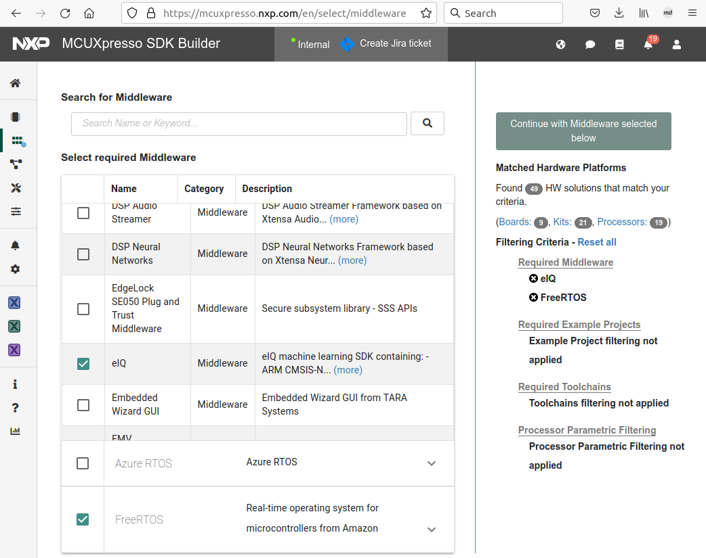
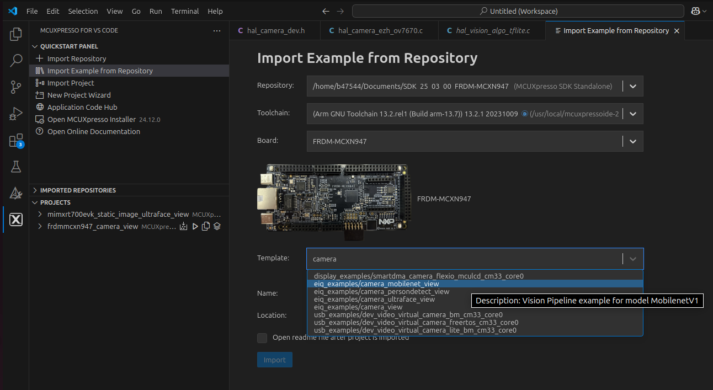
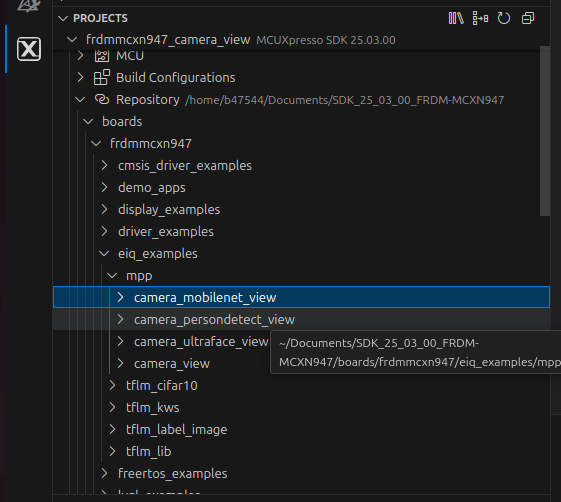
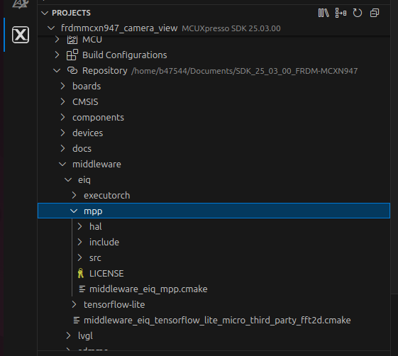
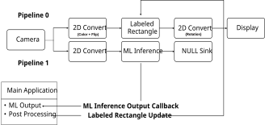
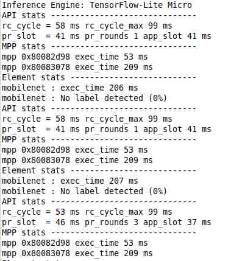

# eIQ Media Processing Pipeline Overview

This document describes the MCU Media Processing Pipeline (MPP) API.

## 1. Features

The Media Processing Pipeline for MCUs is a software library for constructing graphs of media-handling
components for Vision-specific applications.

This is a clean and simple API which makes it easy to build and prototype vision-based applications.

**1.1 Concept**

The concept behind the API is to create a Media Processing Pipeline (MPP) based on processing elements.
The basic pipeline structure - the *mpp* in the API context - has a chain/queue structure which begins
with a **source element**:

- Camera (MIPI CSI, FlexIO, USB/UVC)
- Static image (from memory buffer)
- File source (read from SD card storage)
- Multicore source (receive frames from a paired core over RPMsg)

The pipeline continues with multiple **processing elements** having a single input and a single output:

- Image format conversion (color space conversion, scaling, cropping, rotation, flip)
- Image decoder/decompressor (JPEG SW/HW, H.264 SW)
- Labeled rectangle and landmarks drawing
- Machine learning inference using the following frameworks:
  - TensorFlow Lite Micro
  - ExecuTorch

The pipeline can be closed by adding a **sink element**:

- Display panel
- File sink (write to SD card storage)
- RTSP/RTP network streaming sink
- Null sink
- Multicore sink (send frames to a secondary core over RPMsg)

An *mpp* can also be **split** when the same media stream must follow different processing paths.

**1.2 Multicore Pipelines**

On multicore SoCs (e.g. i.MX RT1170 with Cortex-M7 + M4), the MPP framework supports
distributing pipeline processing across cores using a **multicore source** and a
**multicore sink** element pair connected over RPMsg/MCMGR.

```
Core 0 (CM7)                         Core 1 (CM4)
-----------                          -----------
Camera -> Convert -> MC Sink  ====>  MC Source -> Inference -> Display
```

- `mpp_mc_sink_add()` -- closes a pipeline branch on one core and transmits frames
  to the other core via shared memory and RPMsg signalling.
- `mpp_mc_source_add()` -- opens a pipeline branch on the receiving core that
  consumes frames sent by the paired MC sink.

The underlying HAL multicore device (`hal_mc`) handles RPMsg endpoint setup,
buffer negotiation between cores, synchronization locks, and the enqueue/dequeue
of shared frame buffers. Both elements must be configured with matching
`mpp_mc_params_t` (local/remote RPMsg endpoint addresses and the MCMGR event data
pointer used for inter-core signalling).

Key constraints:

- Each MC sink/source pair must use unique RPMsg endpoint addresses
  (up to `MPP_MAX_RPMSG_EPT_PER_CORE` endpoints per core).
- Call `mpp_boot_secondary_core()` on the primary core before starting the pipeline
  to load and launch the secondary core firmware.
- The secondary core must call `mpp_secondary_core_rpmsg_init()` once it is ready.

Compatibility of elements and supplied parameters are checked at each step and only compatible elements
can be added in an unequivocal way.

After the construction is complete, each *mpp* must be started for all hardware and software required
to run the pipeline to initialize. Pipeline processing begins as soon as the last start call is flagged.

Each pipeline branch can be stopped individually. The process involves stopping the execution and the
hardware peripherals of the branch. After being stopped, each branch can be started again. To stop
the whole pipeline, you must stop each of its branches separately.

At runtime, the application receives events from the pipeline processing and may use these events to
update the element parameters. For example, in object detection when the label of a bounding box must
be updated whenever a new object is detected.

Summarizing, the application controls:

- Creation of the pipeline
- Instantiation of processing elements
- Connection of elements to each other
- Reception of callbacks based on specific events
- Updating specific elements (not all elements can be updated)
- Stopping a branch of the pipeline (includes shut down of the hardware peripherals)

Application does not control:

- Memory management
- Data structures management

The order in which an element is added to the pipeline defines its position within this pipeline,
therefore the order is important.


## 2. Deployment

The eIQ Media Processing Pipeline is part of the eIQ machine learning software package, which is an
optional middleware component of MCUXpresso SDK.

The eIQ component is integrated into the MCUXpresso SDK Builder delivery system available on
[mcuxpresso.nxp.com](https://mcuxpresso.nxp.com/).

To include eIQ Media Processing Pipeline into the MCUXpresso SDK package, select both "eIQ" and
"FreeRTOS" in the software component selector on the SDK Builder page.

For details, see [Figure 1](#figure-1).

<a name="figure-1"></a>



**Figure 1. MCUXpresso SDK Builder software component selector**

Once the MCUXpresso SDK board package is downloaded, it can be extracted on a local machine or imported
into the Visual Studio Code IDE. For more information on the MCUXpresso SDK board support package, see
the section Getting Started > Zip package.

**2.1. How to get example applications**

The eIQ Media Processing Pipeline is provided with a set of example applications. For details, see
[Table 1](#table-1). The applications demonstrate the usage of the API in several use cases.

<a name="table-1"></a>**Table 1. Example applications**

| **Name** | **Description** | **Availability** |
| - | - | - |
| camera\_view | Basic camera preview pipeline. | EVKB-MIMXRT1170, FRDM-IMXRT700, FRDM-MCX N947, FRDM-IMXRT1152, MIMXRT700-EVK |
| camera\_mobilenet\_view | Image classification using quantized MobileNet (TFLite). Classifies input image into one of 1000 output classes. | EVKB-MIMXRT1170, FRDM-IMXRT700, FRDM-MCX N947, MIMXRT700-EVK |
| camera\_ultraface\_view | Face detection using quantized UltraFace slim model (TFLite). Detects multiple faces in input image. | EVKB-MIMXRT1170, FRDM-IMXRT700, FRDM-MCX N947, MIMXRT700-EVK |
| camera\_persondetect\_view | Person detection using quantized FastestDet model (TFLite). Detects multiple persons in input image. | EVKB-MIMXRT1170, FRDM-IMXRT700, FRDM-MCX N947, MIMXRT700-EVK |
| camera\_nanodet\_view | Object detection using quantized NanoDet-m (TFLite). Detects objects from 80 classes. | FRDM-IMXRT700, MIMXRT700-EVK |
| camera\_mobilefacenet\_view | Face recognition using MobileFaceNet (TFLite). Detects and identifies faces. | EVKB-MIMXRT1170, FRDM-IMXRT700, MIMXRT700-EVK |
| camera\_ultraface\_mobilefacenet\_view | Combined face detection + recognition pipeline (TFLite). | EVKB-MIMXRT1170, FRDM-IMXRT700, MIMXRT700-EVK |
| camera\_gesture\_recognition\_view | Hand gesture recognition using Blaze hand detector, landmark detector, and gesture classifier (TFLite). | FRDM-IMXRT700, MIMXRT700-EVK |
| camera\_usb\_final\_fr\_app\_view | Full face recognition application using USB UVC camera (multicore). | FRDM-IMXRT700, MIMXRT700-EVK |
| static\_image\_mobilenet\_view | Image classification from a static image in memory (TFLite). | EVKB-MIMXRT1170, FRDM-IMXRT700, MIMXRT700-EVK |
| static\_image\_ultraface\_view | Face detection from a static image in memory (TFLite). | EVKB-MIMXRT1170, FRDM-IMXRT700, MIMXRT700-EVK |
| static\_image\_persondetect\_view | Person detection from a static image in memory (TFLite). | EVKB-MIMXRT1170, FRDM-IMXRT700, MIMXRT700-EVK |
| static\_image\_nanodet\_view | Object detection from a static image using NanoDet-m (TFLite). Detects objects from 80 classes. | EVKB-MIMXRT1170, FRDM-IMXRT700, FRDM-IMXRT1152, MIMXRT700-EVK |
| static\_image\_mobilefacenet\_view | Face recognition from a static image (TFLite). | EVKB-MIMXRT1170, FRDM-IMXRT700, MIMXRT700-EVK |
| static\_image\_nanodet\_persondetect\_view | Combined NanoDet object detection + person detection from a static image (TFLite). | FRDM-IMXRT700, MIMXRT700-EVK |
| static\_image\_switch\_ultraface\_antispoofing\_mobilefacenet\_view | Face detection + anti-spoofing + face recognition pipeline from a static image (TFLite). | EVKB-MIMXRT1170, FRDM-IMXRT700, MIMXRT700-EVK |

When using Visual Studio Code IDE, the example applications can be imported through the MCUXpresso
plugin in Quickstart Panel > Import Example from Repository as shown in [Figure 2](#figure-2).

<a name="figure-2"></a>



**Figure 2. MCUXpresso SDK import projects wizard**

The *boards* directory contains example application projects for supported toolchains, see
[Figure 3](#figure-3). When using the command line, examples can be built using the MPP build script:

```bash
python3 ./build_mpp.py -b evkbmimxrt1170 -e camera_mobilenet_view
```

<a name="figure-3"></a>



**Figure 3. MCUXpresso SDK board package directory structure for examples**

The *middleware/eiq* directory contains both the inference engine code and the Media Processing Pipeline
code in folder 'mpp', see [Figure 4](#figure-4).

<a name="figure-4"></a>



**Figure 4. MCUXpresso SDK board package directory structure for mpp**


## 3. Example

This section provides a short description of the camera\_mobilenet\_view application.

This example shows how to use the library to create a use case for image classification using camera
as source.

The image classification model used is quantized MobileNet convolutional neural network model that
classifies the input image into one of 1000 output classes. Find more pre-trained models at
<https://www.tensorflow.org/lite/models>.

**3.1 High-level description**

**Figure 5. Application overview**
<a name=""></a> 

**3.2 Detailed description**

The application creates two pipelines:
- One pipeline that runs the camera preview.
- Another pipeline that runs the ML inference on the image coming from the camera.
- Pipeline 1 is split from Pipeline 0.
- Pipeline 0 executes the processing of each element sequentially and cannot be preempted by another pipeline.
- Pipeline 1 executes the processing of each element sequentially but can be preempted.

**3.3 Pipelines elements description**

- Camera element is configured for a specific pixel format and resolution (board dependent).
- Display element is configured for a specific pixel format and resolution (board dependent).
- 2D converts element on pipeline 0 is configured to perform:
  - color space conversion from the camera pixel format to the display pixel format.
  - rotation depending on the display orientation compared to the landscape mode.

    ***Note:** To get labels in the right orientation, the rotation is performed after the labeled-rectangle.*

- 2D converts element on pipeline 1 is configured to perform:
  - color space conversion from the camera pixel format to RGB888.
  - cropping to maintain image aspect ratio.
  - scaling to 128x128 as mandated by the image classification model.
- The labeled rectangle element draws a crop window from which the camera image is sent to the ML
  inference element. The labeled rectangle element also displays the label of the object detected.
- The ML inference element runs an inference on the image pre-processed by the 2D convert element.
- The NULL sink element closes pipeline 1 (in MPP concept, only sink elements can close a pipeline).
- At every inference, the ML inference element invokes a callback containing the inference outputs.
  These outputs are post-processed by the callback client component. In this case, it is the main task
  of the application.

**3.4 Example output**

After building the example application and downloading it to the target, the execution stops in the
*main* function. When the execution resumes, an output message displays on the connected terminal.
For example, [Figure 6](#figure-6) shows the output of the camera\_mobilenet\_view example application
printed to the PuTTY console window.

<a name="figure-6"></a>**Figure 6. PuTTY console window**


