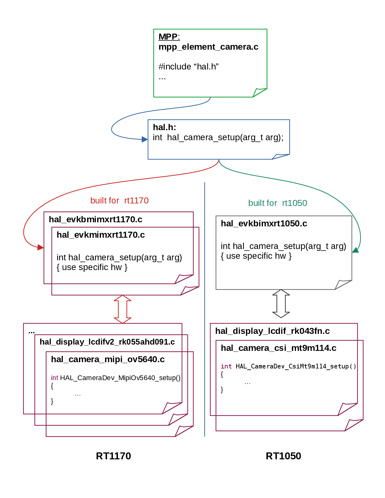

# Hardware Abstraction Layer

This is the documentation for the Hardware Abstraction Layer (HAL) API.

# HAL overview

The hardware abstraction layer abstracts hardware and software components so that the vision pipeline
can leverage hardware-accelerated components whenever they are available.

## MPP HAL description

The HAL is organized around the following conventions:

- A common header file `hal.h` includes all hardware top-level functions.
- All hardware top-level functions use the prefix `hal_`.
- For each platform, all `hal_` functions defined in `hal.h` must be implemented (at least as empty stubs).

Here is an overview:

## MPP HAL components

### Source elements HAL

- Camera (MIPI CSI, FlexIO, USB/UVC)
- Static image (from memory buffer)
- File source (from SD card storage)
- Multicore source (receive frames from another core over RPMsg)

### Processing elements HAL

- Graphics driver (image conversion, scaling, cropping, rotation, flip)
- Image decoder (JPEG SW/HW, H.264 SW)
- Vision algorithms (ML inference: TFLite, ExecuTorch)
- Labeled rectangle and landmarks drawing

### Sink elements HAL

- Display panel
- File sink (write to SD card)
- RTSP/RTP network streaming sink
- Null sink
- Multicore sink (send frames to another core over RPMsg)

### Multicore HAL

The `hal_mc` component provides inter-core communication for multicore pipelines on SoCs such as
i.MX RT1170 (CM7 + CM4). It implements the `mc_dev_operator_t` interface and handles:

- RPMsg endpoint creation and teardown
- Shared-memory buffer negotiation between cores
- Synchronization locks for exclusive buffer access
- Enqueue/dequeue of frame buffers to/from the remote core
- MCMGR event signalling (when `HAL_ENABLE_MULTICORE=1`)

The multicore HAL is enabled by setting `HAL_ENABLE_MULTICORE=1` in `mpp_config.h`.

## Supported devices

At present, the MPP HAL supports the following devices:

- Cameras:
   * OV5640 (MIPI CSI)
   * MT9M114 (parallel, deprecated)
   * OV7670 (FlexIO)
   * USB UVC cameras (e.g. Logitech C920 PRO HD WEBCAM)
- Displays:
   * LVGL (software framebuffer)
   * RK055AHD091 (MIPI DSI 720x1280)
   * RK055MHD091 (MIPI DSI 720x1280)
   * RK043FN02H-CT (parallel, deprecated)
   * Mikroe TFT Proto 5" (SSD1963 controller, FlexIO/LCD DBI)
   * NXP LCD-PAR-S035 (ST7796S controller, 8080 parallel)
   * FBdev (Linux framebuffer)
   * Zephyr display (via Zephyr display driver API)
- Graphics:
   * PXP (Pixel Pipeline, hardware accelerated)
   * VGLite (GPU, hardware accelerated)
   * CPU (software)
- Image decoders:
   * JPEG SW decoder
   * JPEG HW decoder
   * H.264 SW decoder
- Storage:
   * SD card (FatFS)
- RTSP/RTP streaming:
   * H.264 RTP streaming over UDP
- Multicore communication:
   * RPMsg + MCMGR (i.MX RT1170 CM7/CM4)

## Supported boards

Currently, the MPP HAL supports the following boards:

- evkbmimxrt1170 is supported with the following devices:
    * Cameras:  OV5640.
    * Displays: LVGL, RK055AHD091 and RK055MHD091.
    * Graphics: PXP, CPU.
    * Decoders: JPEG SW, JPEG HW.

- frdmmcxn947 is supported with the following devices:
    * Cameras:  OV7670.
    * Displays: Mikroe TFT Proto 5" and NXP LCD-PAR-S035.
    * Graphics: CPU.
    * Decoders: JPEG SW.

- mimxrt700evk is supported with the following devices:
    * Cameras:  OV7670, USB UVC (Logitech C920 PRO HD WEBCAM).
    * Displays: RK055AHD091 and RK055MHD091.
    * Graphics: PXP, VGLite, CPU.
    * Decoders: JPEG SW, JPEG HW.
    * Storage:  SD card.
    * Streaming: RTSP/RTP H.264 (multicore: core0 + core1).
    * Multicore: RPMsg + MCMGR (CM33 + CM33).

- frdmimxrt700 is supported with the following devices:
    * Cameras:  OV7670, USB UVC.
    * Displays: Raspberry Pi 7".
    * Graphics: VGLite, CPU.
    * Decoders: JPEG SW, JPEG HW.
    * Storage:  SD card.

- frdmimxrt1152 is supported with the following devices:
    * Cameras:  OV5640.
    * Displays: RK055AHD091 and RK055MHD091.
    * Graphics: PXP, CPU.
    * Decoders: JPEG SW, JPEG HW.

# How to port new boards/devices

The MPP HAL provides the flexibility for users to port new boards and devices (cameras, displays, etc.).

## Supporting new boards

To support a new board, add a new file `hal_{board_name}.c` under the `hal/` directory.
The file must implement all hardware-specific setup functions declared in `hal.h`.

## Supporting new devices

The HAL components that can support new devices are:
- Cameras
- Displays
- Graphics processing

A new device can be supported by:
- Providing the appropriate `hal_{device_module}` implementation.
- Adding its name and setup entry point to the appropriate device list in the associated board file `hal_{board_name}.c`.

## Enabling/Disabling HAL components and devices

- HAL components can be enabled or disabled from `mpp_config.h` using compilation flags
  of the form `HAL_ENABLE_{COMPONENT_NAME}`.
- Individual HAL devices can also be enabled or disabled from `mpp_config.h` using flags
  of the form `HAL_ENABLE_{DEVICE_NAME}`.
